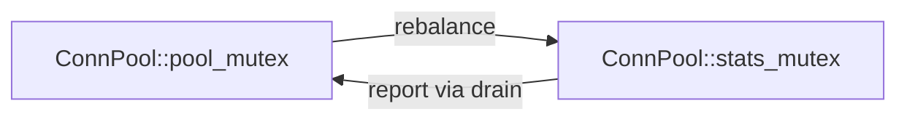

<!-- nav:top -->
📚 [Documentation](README.md) › **MCP tool reference**
<!-- /nav:top -->

# StaticSight MCP tool reference

StaticSight exposes **33 MCP tools** and **5 prompts**. No tool changes your source files: StaticSight writes only to
its data folder `.staticsight/` (indexes, the code graph, stored findings and result pages). The Python and TypeScript
servers behave identically. Names, parameters and the descriptions the agent sees come from
[`shared/tool-spec.json`](../shared/tool-spec.json).

<!-- nav:toc -->
**On this page:** [1. review_changes](#1-review_changes) · [2. get_diff_scopes](#2-get_diff_scopes) · [3. get_enclosing_scope](#3-get_enclosing_scope) · [4. get_branch_skeleton](#4-get_branch_skeleton) · [5. get_upstream_callers](#5-get_upstream_callers) · [6. get_symbol_definition](#6-get_symbol_definition) · [7. get_symbol_contract](#7-get_symbol_contract) · [8. track_struct_risks](#8-track_struct_risks) · [9. get_include_blast_radius](#9-get_include_blast_radius) · [10. track_state_mutations](#10-track_state_mutations) · [11. track_lock_order](#11-track_lock_order) · [12. run_file_static_audit](#12-run_file_static_audit) · [13. semantic_search](#13-semantic_search) · [14. find_similar_code](#14-find_similar_code) · [15. refresh_semantic_index](#15-refresh_semantic_index) · [16. get_index_status](#16-get_index_status) · [17. check_my_edit](#17-check_my_edit) · [18. plan_change](#18-plan_change) · [19. get_context_pack](#19-get_context_pack) · [20. get_impact](#20-get_impact) · [21. get_call_paths](#21-get_call_paths) · [22. find_entry_paths](#22-find_entry_paths) · [23. get_type_hierarchy](#23-get_type_hierarchy) · [24. query_graph](#24-query_graph) · [25. get_lock_graph](#25-get_lock_graph) · [26. find_switch_coverage](#26-find_switch_coverage) · [27. find_counterparts](#27-find_counterparts) · [28. find_related_tests](#28-find_related_tests) · [29. get_line_history](#29-get_line_history) · [30. get_change_hotspots](#30-get_change_hotspots) · [31. find_log_origin](#31-find_log_origin) · [32. verify_finding](#32-verify_finding) · [33. get_more](#33-get_more) · [Prompts](#prompts) · [Engines at a glance](#engines-at-a-glance)
<!-- /nav:toc -->

Every tool returns concise Markdown with `file:line` references, and keeps to an output budget
(`STATICSIGHT_MAX_CHARS`, default 6000 characters; 16000 for `review_changes`). Lists longer than
`STATICSIGHT_MAX_RESULTS` (default 15) end with "…and N more. Next: `get_more("P1a2b3c")`": the rest is kept, and
[`get_more`](#33-get_more) returns it page by page. Errors never crash the server. They come back as a card like
`### ❌ Invalid argument` with a 💡 hint.

**Findings have IDs.** Leaks on exit paths, cppcheck errors and warnings, ignored results, lock-order cycles, locks
taken twice or held across blocking calls, unlocked accesses, switch gaps, unchanged counterparts and stale callers
carry a short ID such as `F7a0cc5`. The same issue gets the same ID on every run and in both implementations.
[`verify_finding`](#32-verify_finding) re-checks one on the current code. Over MCP, a result that contains findings
also carries them as **structured content** (`{"findings": [{"id", "kind", "confidence", "path", "line", "symbol",
"message", "function"}]}`) next to the Markdown; clients that do not read structured content lose nothing.

**The code graph.** The tools marked "code graph" read a small SQLite database of definitions, calls and includes
(`.staticsight/graph.db`), built from ctags and the comment-stripped source. Every call checks it against the files
first: nothing changed → answer; up to 300 changed files (after a `git pull`, a branch switch or an edit) → re-parse
them, then answer; more → refresh in the background and answer from the previous graph (or GNU Global) with a note.
You never have to rebuild it by hand. See [the code graph](code-graph.md).

**Common conventions**
- `file_path` is relative to `WORKSPACE_ROOT`. Absolute paths inside the workspace are accepted. Paths that
  escape the workspace (including via symlinks) are rejected.
- `symbol` must be a C++ identifier. A `Class::` prefix and a trailing `()` are accepted and stripped.
- `base_ref` empty means the merge-base with `origin/main`, then `origin/master`, `main`, `master`, `HEAD`
  (or `STATICSIGHT_BASE_REF`). The diff always includes committed, staged, unstaged and untracked changes.
- `path_glob` is an fnmatch pattern such as `src/net/*`. `*` also matches `/`. `\` is accepted as a separator.
  Matching is case-insensitive on Windows (like its file system) and case-sensitive on Linux/macOS.
- Paths in output always use `/`, on every OS. Source files with a UTF-8 or UTF-16 BOM (common in MSVC repos) are
  decoded correctly, and the BOM never hides a line-1 `#include`.
- Output markers: ✏️ changed in the diff · 🔶 inside a changed function · 🛑 early exit · ⚠️ heuristic warning
  · 🔒 lock · 📥 allocation · 📤 release.

**Review and edit**

| # | Tool | One-line purpose |
|---|---|---|
| 1 | [`review_changes`](#1-review_changes) | Full review bundle for the current diff in one call |
| 17 | [`check_my_edit`](#17-check_my_edit) | Fast self-check of your uncommitted edits, after every edit |
| 18 | [`plan_change`](#18-plan_change) | Every place to touch before you edit a function, in order |
| 2 | [`get_diff_scopes`](#2-get_diff_scopes) | Which functions/types/macros the diff touches |
| 12 | [`run_file_static_audit`](#12-run_file_static_audit) | cppcheck findings for one file, mapped to the diff |

**Read code cheaply**

| # | Tool | One-line purpose |
|---|---|---|
| 3 | [`get_enclosing_scope`](#3-get_enclosing_scope) | Full code of the function/class around a line |
| 4 | [`get_branch_skeleton`](#4-get_branch_skeleton) | Control-flow tree with lock/alloc/leak annotations |
| 19 | [`get_context_pack`](#19-get_context_pack) | Everything about one function in one call, within a budget |
| 6 | [`get_symbol_definition`](#6-get_symbol_definition) | Where a symbol is defined (incl. overloads) |
| 7 | [`get_symbol_contract`](#7-get_symbol_contract) | Signature, qualifiers, doc comment, obligations |

**Calls, reach and structure (code graph)**

| # | Tool | One-line purpose |
|---|---|---|
| 5 | [`get_upstream_callers`](#5-get_upstream_callers) | Who calls a function, and whether they use the result |
| 20 | [`get_impact`](#20-get_impact) | Callers of callers, several levels deep, with entry points and tests |
| 21 | [`get_call_paths`](#21-get_call_paths) | The call chains from one function to another |
| 22 | [`find_entry_paths`](#22-find_entry_paths) | Which program entry points, threads and callbacks reach a function |
| 23 | [`get_type_hierarchy`](#23-get_type_hierarchy) | Base and derived classes, virtual methods and their overrides |
| 24 | [`query_graph`](#24-query_graph) | Free-form structural questions: `callers*2 of X in src/*` |

**Memory, headers and concurrency**

| # | Tool | One-line purpose |
|---|---|---|
| 8 | [`track_struct_risks`](#8-track_struct_risks) | Code that depends on a struct's exact byte layout |
| 9 | [`get_include_blast_radius`](#9-get_include_blast_radius) | Files affected by a header change |
| 10 | [`track_state_mutations`](#10-track_state_mutations) | Reads/writes of shared state and their locking |
| 11 | [`track_lock_order`](#11-track_lock_order) | Lock-acquisition order: potential deadlocks, same lock twice, locks held across blocking calls |
| 25 | [`get_lock_graph`](#25-get_lock_graph) | Map of a module's locks, who takes them, and in which order (Mermaid) |

**Is the change complete?**

| # | Tool | One-line purpose |
|---|---|---|
| 26 | [`find_switch_coverage`](#26-find_switch_coverage) | Switches that miss a value of an enum |
| 27 | [`find_counterparts`](#27-find_counterparts) | encode/decode pairs, `_win`/`_posix` twins, files that change together |
| 28 | [`find_related_tests`](#28-find_related_tests) | The tests that reach a function, or that none do |

**History and investigation**

| # | Tool | One-line purpose |
|---|---|---|
| 29 | [`get_line_history`](#29-get_line_history) | Why lines look the way they do; earlier fixes on them |
| 30 | [`get_change_hotspots`](#30-get_change_hotspots) | Files that change often, need fixes and are used widely |
| 31 | [`find_log_origin`](#31-find_log_origin) | From a log line to the code that printed it |
| 13 | [`semantic_search`](#13-semantic_search) | Find code by meaning across every language in the repo |
| 14 | [`find_similar_code`](#14-find_similar_code) | Copy-paste twins / parallel implementations of a region |

**Trust and housekeeping**

| # | Tool | One-line purpose |
|---|---|---|
| 32 | [`verify_finding`](#32-verify_finding) | Re-check a finding by its ID before reporting it |
| 33 | [`get_more`](#33-get_more) | The next page of a truncated list |
| 15 | [`refresh_semantic_index`](#15-refresh_semantic_index) | Build or refresh the semantic index on demand |
| 16 | [`get_index_status`](#16-get_index_status) | Index states (GNU Global, semantic, code graph), engines, model |

**Prompts:** [`review_cpp_changes`, `investigate_hang`, `investigate_incident`, `plan_refactor`, `onboard_me`](#prompts).
Numbers are stable section numbers (1-16 are the original tools); the MCP server lists the tools in the order above.

---

## 1. `review_changes`

**What it does:** runs the most useful tools for the current diff and merges the results into one report, within
the output budget. This is the entry point for "review my changes" and "what could break?".

| Parameter | Type | Default | Meaning |
|---|---|---|---|
| `base_ref` | string | `""` | Diff base (see conventions). Use e.g. `HEAD~1` for "my last commit". |
| `max_symbols` | integer | `8` | How many changed functions/types to analyse in depth (1-25). |

**Sections of the report**
1. **What changed:** compact `get_diff_scopes` output.
2. **Static audit:** `run_file_static_audit(only_changed_lines=true)` on up to 6 changed source files.
3. **Branch skeletons** of changed functions. Modified functions come before new ones. Functions without
   branches are listed on one line.
4. **Caller impact** for modified functions, changed declarations, and removed functions.
5. **Memory-layout risks** for structs/classes whose data members or virtuals changed.
6. **Header blast radius** for changed headers.
7. **Lock consistency:** `track_state_mutations` for class members used by changed functions. It is only shown
   when locking is inconsistent.
8. **Lock order:** `track_lock_order` focused on the locks that changed functions take. It is only shown (and only
   run) when a changed function takes a lock and there is a cycle, a lock taken twice, or a lock held across a blocking call.
9. **Calls introduced by the diff:** functions newly called in added lines. Check their contracts.
10. **Similar code elsewhere:** near-duplicates of changed functions, when the semantic index exists.
11. **Reach of changed functions** (code graph): how many functions are affected within 3 calls, which program entry
    points and threads reach each changed function, and which tests do (⚠️ none).
12. **Completeness:** switches that miss a value of an enum the change uses, and `_win`/`_posix` twins of changed
    functions that were not changed.
13. **Earlier fixes on the changed lines:** bug-fix or revert commits (before this change) that touched them.

The **reviewer checklist** comes last: items generated from what was found, plus two standing reminders. Its space is
reserved, so it survives even when the sections above it are shortened to fit the budget.

**Engines:** git, ctags, GNU Global/ripgrep, cppcheck, the code graph.

---

## 2. `get_diff_scopes`

**What it does:** maps every changed line to the innermost C++ scope that contains it (function, method, class,
struct, union, enum or macro) and describes the change.

| Parameter | Type | Default | Meaning |
|---|---|---|---|
| `base_ref` | string | `""` | Diff base. |
| `path_glob` | string | `""` | Restrict to matching files, e.g. `src/net/*`. |

**How it works:** `git diff -U0 -M <base>` plus `git ls-files --others` for untracked files. Hunks are parsed
into added lines and removal points. Universal Ctags (JSON, with end lines) runs on the current file, and on the
**old blob** of the file so old and new symbols can be compared.

**It reports, per file:**
- Changed scopes with changed line ranges and removed-line counts.
- 🆕 new symbols and 🗑️ removed symbols.
- 🔁 signature changes, shown as old → new.
- 🧱 layout changes when data members, enumerators or virtuals change. Method-only changes are reported as
  "declarations changed".
- Macros defined or changed, changed `#include` lines, and file-level lines outside any scope.
- A one-line summary for new files; deleted and renamed files.
- **Suggested next calls** at the end, listing which tool to run for which item.

---

## 3. `get_enclosing_scope`

**What it does:** returns the innermost function/method/class/struct around a line, with its qualified name,
signature, parent scope, line range and line-numbered source. The target line is marked `>`.

| Parameter | Type | Default | Meaning |
|---|---|---|---|
| `file_path` | string | required | File to inspect. |
| `target_line` | integer | required | 1-based line number. |

**Details**
- Scopes over 150 lines are shortened: the first 15 lines, ±30 lines around the target, and the last 10 lines.
- If no scope contains the line (global code, preprocessor blocks), it shows ±12 lines of file-level context.
- Anonymous namespaces are shown as `(anonymous)`.

---

## 4. `get_branch_skeleton`

**What it does:** shows only the control flow of a function as a tree, so logic and error paths can be checked
without reading the whole body.

| Parameter | Type | Default | Meaning |
|---|---|---|---|
| `file_path` | string | required | File containing the function. |
| `symbol` | string | `""` | Function name, e.g. `process_packet` or `Router::process_packet`. |
| `start_line` | integer | `0` | Used alone: the function enclosing this line. |
| `end_line` | integer | `0` | Used with `start_line`: an explicit range. |

**What it shows**
- Nodes: `if` / `else if` / `else` / `switch` / `case` / `default` / `for` / `while` / `do` / `try` / `catch` /
  `return` / `co_return` / `throw` / `break` / `continue` / `goto`, with conditions and return values.
- Annotations: 🔒 lock acquisitions, 🔓 unlocks, 📥 allocations, 📤 releases. Resource pairs cover C/C++
  (`malloc`/`free`, `new`/`delete`, `fopen`/`fclose`), POSIX (`open`/`close`, `socket`/`close`, `mmap`/`munmap`),
  Win32 (`CreateFile*`/`CloseHandle`, `OpenSCManager*`/`OpenService*`/`CloseServiceHandle`, `CoTaskMemAlloc`/`CoTaskMemFree`,
  `SysAllocString*`/`SysFreeString`, ...) and COM `->Release()`.
- 🛑 for early exits; ↩ for final returns.
- ⚠️ when an exit leaves an allocation unreleased. Paths already guarded by a failure check such as
  `if (h == INVALID_HANDLE_VALUE)`, `if (fd < 0)` or
  `if (buf == nullptr)` are not flagged.
- ✏️ on lines changed in the current diff.
- A summary line with the number of returns, throws, early exits, loops and potential leak paths.
- Each potential leak carries a finding ID in brackets, e.g. `[F7a0cc5]`.

**How it works:** comments and string literals are blanked first (column-preserving, raw strings and digit
separators included). Nesting comes from brace depth, not indentation. Single-statement `if`/`else` bodies are
handled. This is a heuristic, and the output says so.

---

## 5. `get_upstream_callers`

**What it does:** lists every call site of a function, with the calling function and how the return value is used.

| Parameter | Type | Default | Meaning |
|---|---|---|---|
| `symbol` | string | required | Function/method name. |
| `path_glob` | string | `""` | Restrict caller files. |

**How it works:** `global --result=ctags -r` against the background GNU Global index; the tab-delimited result preserves
paths containing spaces, and StaticSight reads the source line itself. If the index is not available, it falls
back to a ripgrep search for `symbol(` and `&symbol`, and the output says "ripgrep fallback".

**Filtering and classification**
- Removed from the results: hits in comments or strings, the declaration/definition itself, and variables or
  parameters that merely share the name.
- Each remaining call is classified:
  - **result used**
  - **⚠️ result ignored**, a bare statement like `obj->f(x);`
  - **result explicitly discarded**, `(void)f(x)`
  - **referenced (address/callback)**
- For `void` functions no classification is shown.
- The header states the return type and how many callers ignore it. Each ignored result carries a finding ID.
- Call sites are grouped by file. When results are truncated, the top files are listed.
- When the method is virtual (from the code graph), a note names the overrides: a call through a base pointer can
  reach any of them, and [`get_impact`](#20-get_impact) resolves them through the class hierarchy.

---

## 6. `get_symbol_definition`

**What it does:** finds where a symbol is defined: functions, methods, classes, structs, unions, enums, macros,
typedefs, namespaces, variables and members. Overloads are included.

| Parameter | Type | Default | Meaning |
|---|---|---|---|
| `symbol` | string | required | Symbol name. |

**How it works:** `global --result=ctags -d`, enriched with ctags kind and signature. If GNU Global finds nothing (for example
data members), or is unavailable, it uses ripgrep to find candidate files and ctags to find definitions. The
engine used is shown in the header.

---

## 7. `get_symbol_contract`

**What it does:** shows what a function or type requires of the code that uses it.

| Parameter | Type | Default | Meaning |
|---|---|---|---|
| `symbol` | string | required | Function or type name. |

**It reports**
- **Declarations**, from headers first, and **definitions**, each with the full signature.
- **Qualifiers:** `const`, `noexcept`, `virtual`, `override`, `final`, `static`, `inline`, `constexpr`,
  `explicit`, `[[nodiscard]]`, `[[deprecated]]`, `template`, `= delete`, `= default`, pure virtual.
- **The doc comment** directly above the declaration or definition (`/** */`, `///`, `//!`, `//` blocks, or a
  trailing `///<`).
- **Obligations / preconditions:** Doxygen tags (`@pre`, `@post`, `@return`, `@throws`, `@warning`, `@note`,
  `@invariant`, ...) with their continuation lines, plus sentences with words like MUST, NEVER, thread-safe,
  ownership, non-null, lock, release, paired.
- **The body**, when it is short (functions up to 25 lines, types up to 40). Otherwise it points you to
  `get_branch_skeleton`.

---

## 8. `track_struct_risks`

**What it does:** finds code whose correctness depends on the exact byte layout of a struct/class. Use it whenever
members are added, removed, reordered or resized.

| Parameter | Type | Default | Meaning |
|---|---|---|---|
| `struct_name` | string | required | Type name, e.g. `Packet`. |
| `path_glob` | string | `""` | Restrict files. |

**Risk categories** (the matching line and the 2 lines around it are checked; comments are ignored)

| Label | Matches | Why it matters |
|---|---|---|
| 🌐 raw I/O | `send`, `recv`, `write`, `read`, `fwrite`, `fread`, `ioctl`, `mmap`, ... | Wire/disk format breaks for peers or data from older code |
| 🧬 raw memory op | `memcpy`, `memmove`, `memset`, `memcmp`, ... | Offsets shift; `memcmp` also compares padding |
| 📏 size/offset assumption | `sizeof`, `offsetof`, `alignof` | Buffer sizes and protocol lengths change silently |
| 🎭 type punning | `reinterpret_cast`, `bit_cast`, C-style `(T*)` casts | Layout must match the producer exactly |
| 📦 packing/alignment | `#pragma pack`, `__attribute__((packed/aligned))`, `alignas` | Alignment/ABI assumptions |
| ✅ layout assertion | `static_assert` | Must be updated deliberately |
| 🔀 union aliasing | `union` | All members must stay compatible |
| 🔁 byte-order conversion | `hton*`, `ntoh*`, `htobe*`, `bswap*` | New fields need matching conversion |
| 🗃️ serialization | `*serialize*`, `*marshal*`, `*encode*`, `*decode*` | Encoders/decoders need the new member |

Each hit shows `file:line`, the enclosing function, the labels, and the code line. Hits where the operation is
only on a neighbouring line are marked "(operation within ±2 lines)". The type's own definition location is
listed, and a "Why it matters" legend explains each label found.

---

## 9. `get_include_blast_radius`

**What it does:** lists the files that `#include` a header, directly and through other headers, so you know what a
header change recompiles and can affect.

| Parameter | Type | Default | Meaning |
|---|---|---|---|
| `header_filename` | string | required | `packet.hpp` or `src/net/packet.hpp`. |
| `transitive_depth` | integer | `2` | 1 = direct only; 2-3 = follow including headers. |

**It reports**
- Direct and transitive includers, grouped by directory, each with the exact `#include` line.
- The number and share of translation units affected.
- A warning when a bare `#include "x.h"` could refer to several headers with that name.
- A "high fan-out" note for widely used headers.

**How it works:** ripgrep `--json` with an escaped pattern. Includes are matched by path suffix and by resolving
relative `../` paths, so a `.` in the name can't match any character.

---

## 10. `track_state_mutations`

**What it does:** finds every access to a variable or member and whether it is protected. Use it when shared state,
mutexes or concurrency are involved.

| Parameter | Type | Default | Meaning |
|---|---|---|---|
| `symbol` | string | required | Variable/member name, e.g. `route_count`. |
| `file_path` | string | `""` | Restrict to one file. |

**Access kinds**
- **write:** `=`, compound assignment, `++`/`--`.
- **mutating call:** `push_back`, `insert`, `erase`, `clear`, `store`, `fetch_*`, `set*`, ...
- **address taken**, **read**, **declaration**, and **lock operation** (the symbol is itself a mutex).

**Sync column**
- 🔒 the lock that is active at that line: std RAII guards (`lock_guard`, `unique_lock`, `scoped_lock`, `shared_lock`),
  `.lock()` / `std::lock`, Win32 critical sections and SRW locks (`EnterCriticalSection`, `AcquireSRWLockExclusive/Shared`),
  and RAII wrappers whose type names a lock (`CAutoLock l(&m_cs)`), honouring block scope and unlocks.
- ⚛️ atomic, when the declaration is `std::atomic`.
- ctor/dtor, for constructors and destructors.
- ❌ BARE, when nothing protects the access.

It flags **inconsistent locking** (the same state accessed with and without a lock), which is a likely data race.
It also warns when a shared lock is used for a write. Locks held by callers are not visible; the output notes this.

---

## 11. `track_lock_order`

**What it does:** finds potential deadlocks. It builds the lock-acquisition order of the whole repository ("B is taken
while A is held"), inside each function and through one level of calls, and reports where two code paths take the
same locks in opposite orders.

| Parameter | Type | Default | Meaning |
|---|---|---|---|
| `path_glob` | string | `""` | Restrict the scanned files, e.g. `src/net/*`. |
| `symbol` | string | `""` | Focus on one lock (mutex, critical section, SRW lock), e.g. `route_mutex`. |

**It reports**
- **⚠️ Potential deadlock cycles:** `A → B → A` (up to 4 locks), with the `file:line` evidence for each direction,
  including "via `drain()`" when the second lock is taken by a called function.
- **⚠️ Same lock taken twice:** a non-recursive lock (std mutexes, SRW locks) taken again while held, directly or by an
  unconditionally locking callee. Critical sections are re-entrant and are not flagged.
- **⏳ Locks held across blocking calls:** `send`/`recv`/`connect`/`select`, file I/O, `Sleep`, `WaitForSingleObject`,
  `std::this_thread::sleep_for`, ...: latency, and a deadlock if the other side needs the lock.
- **Acquisition order:** every A → B pair with an example location.

**How it works**
- ripgrep finds the files that take locks; ctags gives each function's boundaries. Each function body is walked with
  comments and strings removed, tracking the locks held at each line (block scope for RAII guards, explicit unlocks).
- Recognised: std guards, `m.lock();` (a statement; `weak_ptr::lock()` is not a mutex), `std::lock(a, b)`, Win32
  `EnterCriticalSection` and `AcquireSRWLockExclusive/Shared`, RAII wrappers whose type names a lock. `Try*` variants
  are conditional and not counted.
- Locks are matched by name; member names are qualified by class (`ConnPool::pool_mutex`), so `m_lock` of two classes
  stays distinct. Calls through another object (`other.f()`, `p->f()`) are not followed: that object has its own locks.
  A lock taken in an `if` branch is not "held" in the `else` branch.

**Limits (labelled in the output):** one call level; no aliasing (two names for one mutex); runtime conditions and
lock hierarchies are not modelled. Treat findings as precise leads to confirm.

**Example** (test repository):

```text
⚠️ **1 potential deadlock cycle** (locks taken in opposite orders):
1. `ConnPool::pool_mutex` → `ConnPool::stats_mutex` → `ConnPool::pool_mutex`
   - `src/net/conn_pool.cpp:18` in `ConnPool::rebalance`: holds `ConnPool::pool_mutex` (L18), takes `ConnPool::stats_mutex` at L19
   - `src/net/conn_pool.cpp:31` in `ConnPool::report`: holds `ConnPool::stats_mutex` (L31), takes `ConnPool::pool_mutex` via `ConnPool::drain()` at L33

⏳ **Locks held across blocking calls** (latency, and deadlock if the other side needs the lock):
- `src/net/conn_pool.cpp:34` in `ConnPool::report`: `send()` while holding `ConnPool::stats_mutex`
```

---

## 12. `run_file_static_audit`

**What it does:** runs cppcheck on one C/C++ file without building it, and maps the findings onto the diff.

| Parameter | Type | Default | Meaning |
|---|---|---|---|
| `file_path` | string | required | `.c`/`.cpp`/header to analyse. |
| `only_changed_lines` | boolean | `false` | Keep only findings on changed lines (✏️) or inside changed functions (🔶). |
| `base_ref` | string | `""` | Diff base used to find changed lines. |

**How it works**
- Runs `cppcheck --xml --enable=warning,style,performance,portability --inline-suppr` with best-effort `-I` paths:
  the file's folder, parent folders, and `include`/`inc`/`src` folders. Missing-include noise is suppressed.
- **MSVC mode:** when the file targets Windows (`windows.h`-family includes, SAL annotations such as `_In_`/`__out`,
  or several Win32 types), cppcheck also gets `--library=windows --platform=win64 -D_WIN32 -D_MSC_VER=1930`. It then
  knows the Win32 API, for example reporting a `CreateFileW` handle that isn't closed on an error path as
  `resourceLeak`. This applies on any host OS; `STATICSIGHT_CPPCHECK_MSVC=0` disables it and `=1` forces it.
- **Project allocators:** doc comments such as "MUST be paired with release_buffer()" or "free with pool_free()" are
  turned into a cppcheck library (`.staticsight/cppcheck-project.cfg`, passed with `--library=`). cppcheck then
  reports leaks of your own allocators too, not only `malloc`/`new`; the output names the pairs it used.
- Errors and warnings carry finding IDs.
- If included headers can't be parsed (for example an unknown macro), it automatically re-runs without include
  paths and names the macro. Extra flags can be passed with `STATICSIGHT_CPPCHECK_ARGS`.
- Findings are sorted error → warning → portability → performance → style. Each shows its id, CWE number,
  source line and extra locations. Findings located in headers are counted but omitted.

---

## 13. `semantic_search`

**What it does:** finds code by **meaning** across the whole repository (C/C++, C#, Python, scripts, docs, configs), for
when you know what the code does but not what it is called.

| Parameter | Type | Default | Meaning |
|---|---|---|---|
| `query` | string | required | Natural-language description (identifiers may be included). |
| `path_glob` | string | `""` | Restrict files, e.g. `src/net/*`. |
| `language` | string | `""` | e.g. `cpp`, `c`, `csharp`, `python`, `markdown`, `yaml`. |
| `kind` | string | `""` | Chunk kind, e.g. `function`, `class`, `section`, `window`, `file`. |
| `top_k` | integer | `10` | 1-30 results. |

**How it works:**
- A local code-embedding model (ONNX, CPU, offline) ranks functions, classes and sections by cosine similarity.
- A keyword pass (ripgrep) runs in parallel.
- Both lists are fused (reciprocal-rank fusion, keyword weight 0.5) and grouped per symbol.

**Each result** shows `file:start-end`, kind and qualified name, language, cosine score, and why it matched
(`semantic`, `keyword` or `semantic+keyword`), plus a short numbered excerpt.

**Freshness:** before searching, the index is checked for drift:
- **Up to 200 changed files:** they are refreshed first, and the result says so.
- **Larger drift:** refreshes in the background, and the result is marked stale.
- **No index yet:** the first build starts in the background and keyword-only results are shown.

See [semantic search](semantic-search/README.md) and its [internals](semantic-search/internals.md).

---

## 14. `find_similar_code`

**What it does:** finds code elsewhere that is semantically similar to a region: copy-paste twins, Windows/Linux variants,
encode/decode pairs, and places that probably need the same fix.

| Parameter | Type | Default | Meaning |
|---|---|---|---|
| `file_path` | string | required | Source file. |
| `start_line` | integer | required | Alone: the enclosing function/chunk is the source. |
| `end_line` | integer | `0` | Explicit range end (optional). |
| `top_k` | integer | `8` | 1-30 results. |

The source region itself is excluded. Results are labelled `near-duplicate` (≥ 0.92), `very similar` (≥ 0.85) or `similar`.
`review_changes` uses the same logic for its "Similar code elsewhere" section.

---

## 15. `refresh_semantic_index`

**What it does:** builds or refreshes the semantic index on demand, for example after `git pull`.
- It is incremental: only files whose content changed are re-embedded.
- Small refreshes finish before returning; large ones continue in the background (`get_index_status` shows progress and ETA).
- `full=true` rebuilds from scratch.
- It is the only tool that writes, and only to StaticSight's data folder (`<repo>/.staticsight/`, ignored by git), never to source files.

---

## 16. `get_index_status`

**What it does:** also reports the **semantic index**: its state (ready / building with progress and ETA / not built /
needs rebuild / failed), files, chunks and vectors, skipped files by reason, languages, model and database path.

It also reports the platform (`posix`/`windows`), each engine's version, and problems with a fix hint (for
example a ctags without JSON support). It also reports the GNU Global index state (`building`, `ready`, `failed`,
`unavailable`), its database
location and age, and whether `ctags`, `global`, `gtags`, `rg`, `cppcheck` and `git` are installed. No parameters.

**Indexing behaviour**
- The index is built in the background after the MCP handshake (the command line `staticsight tool …` builds it first).
  It lives in `<repo>/.staticsight/`, next to the semantic index, or in the repository root when a `GTAGS` file already
  exists there. `STATICSIGHT_DATA_DIR=cache` (or a read-only repository) puts it in the per-user cache.
- It is refreshed incrementally after `STATICSIGHT_REINDEX_SECONDS` (default 300).
- Graph tools wait up to 2 seconds for it, then use the ripgrep fallback.

It also reports the **code graph**: state (not built, building with progress, ready with the time of the last refresh
and the HEAD it saw), counts of files, definitions, calls and includes, and the database path.

---

## 17. `check_my_edit`

**What it does:** a fast self-check of your own uncommitted edits, meant to run after every edit while you code
(`review_changes` is the full review before committing).

| Parameter | Type | Default | Meaning |
|---|---|---|---|
| `baseline` | string | `"last"` | `"last"`: only functions changed since the previous `check_my_edit` call. `"HEAD"`: every uncommitted change. |

**For each changed function it checks**
- **Exit paths that leak** what the function allocates (the branch-skeleton analysis).
- **cppcheck errors on the changed lines**, including leaks of project allocators (see section 12).
- **Callers outside the change that still use an old signature** (❌ strong: the call will not compile or will
  call the wrong overload).
- **Switches that miss a value** of an enum the changed lines use.
- **Platform twins that were not changed** (`_win`/`_posix`, same name in another platform folder).

Every finding has an ID; the list is sorted strongest first. The baseline is a small snapshot of function-body hashes in
`.staticsight/edit_snapshot.json`.

**Example** (test repository, after adding a `len` parameter and an early return to `decode_msg`, and a guard to the
POSIX `start_timer`):

```text
### 🩺 EDIT CHECK: 2 changed functions since the last check
- `decode_msg` (`src/net/proto.cpp:16`): signature `int (const char * in,MsgType * t)` → `int (const char * in,MsgType * t,int len)`
- `start_timer` (`src/platform/timer_posix.cpp:3`)

**5 findings**
- ❌ `F9ff2d6` `src/net/proto.cpp:19` Memory leak: scratch
- ❌ `F5aae03` `tests/test_proto.cpp:9` `TEST(Proto,RoundTrip)` calls `decode_msg` but its file is not part of the change, so it still uses the old signature
- ⚠️ `F5d6793` `src/net/proto.cpp:19` return at line 19 leaves `scratch` (L17) unreleased
- ⚠️ `F9aa704` `src/net/proto.cpp:37` switch in msg_name misses Ping (falls into default)
- ⚠️ `Ff8880b` `src/platform/timer_win.cpp:3` `start_timer` (src/platform/timer_posix.cpp:3) changed but its counterpart `start_timer` (src/platform/timer_win.cpp:3) did not
```

---

## 18. `plan_change`

**What it does:** plans a change to one function before you edit it, as an ordered checklist.

| Parameter | Type | Default | Meaning |
|---|---|---|---|
| `symbol` | string | required | Function name, optionally qualified. |
| `change` | string | `""` | Short description of the change, e.g. `add a timeout parameter`. Words such as *signature*, *parameter*, *rename*, *remove* or *return type* turn "check the call sites" into "update the call sites". |

**The plan lists:** the definition; every declaration; overrides (virtual methods); call sites grouped by file with
line ranges; naming pairs and platform twins to mirror; how many files include its header; the tests that reach it
(or "add a test first"); the contract to keep (`@pre`, `@warning`, MUST/NEVER); and risks: earlier fixes on these lines,
locks it takes, callers that ignore its result.

```text
### 🗺️ CHANGE PLAN: `decode_msg` (add a length parameter)
**Target:** `decode_msg` (`src/net/proto.cpp:16`) · returns `int`

**Steps**
1. [ ] Edit the definition: `src/net/proto.cpp:16`
2. [ ] Update the declaration: `src/net/proto.hpp:6`
3. [ ] Update 1 call site in 1 file: `tests/test_proto.cpp` L9
4. [ ] Mirror the change in counterparts: `encode_msg` (`src/net/proto.cpp:5`)
5. [ ] Expect a rebuild of `src/net/proto.hpp` includers: 2 files include it directly (…)
6. [ ] Run the tests that reach it: `TEST(Proto,RoundTrip)` (`tests/test_proto.cpp:5`)

**Risks**
- 1 earlier fix touched it: `c945b10` fix: crash on null buffer in decode_msg. Do not undo it.
- 1 caller ignores the `int` result: new error values will go unnoticed there.
```

---

## 19. `get_context_pack`

**What it does:** everything an agent needs about one function in a single call, within a character budget, instead
of five or six separate calls.

| Parameter | Type | Default | Meaning |
|---|---|---|---|
| `target` | string | required | Function name (`Router::process_packet`) or `file:line` inside it. |
| `max_chars` | integer | `6000` | Budget for the whole pack (2000-12000). |

**Sections, in priority order:** location and signature; the documented contract and its obligations; the branch
skeleton (with leak IDs); callers with result used/ignored; callees in the repository and outside it (libraries,
SDK, macros); types in the signature; locks it takes; tests that reach it; recent git history with fixes marked 🐞.
Lower sections are dropped first when the budget is tight.

---

## 20. `get_impact`

**What it does:** shows everything a change to a function can affect, several levels deep, in one call.

| Parameter | Type | Default | Meaning |
|---|---|---|---|
| `symbol` | string | required | Function name, optionally qualified. |
| `depth` | integer | `3` | Call levels to follow (1-6). |
| `direction` | string | `"callers"` | `callers` (who is affected) or `callees` (what it depends on). |
| `path_glob` | string | `""` | Restrict results to matching files. |

Each call site shows `file:line`, whether the result is used or ignored, and tags callers that are 🚪 program entry
points (`main`, `WinMain`, `DllMain`, `ServiceMain`), 🧵 thread start routines or callbacks, or 🧪 tests. Virtual
methods include their overrides. A **Reach** line sums up functions, files, modules, entry points and tests. When the
code graph is not ready yet, it answers with direct callers from GNU Global and says so.

```text
### 🌊 IMPACT: `process_packet` (callers, depth 3)
**Target:** `Router::process_packet` — `src/router.cpp:9` · returns `int`
- **Depth 1:** 4 call sites in 4 functions
  - `Listener::on_socket_read` — `src/net/listener.cpp:9` — result used
  - `Listener::dispatch_batch` — `src/net/listener.cpp:17` — ⚠️ result ignored
  - `pump_loop` 🧵 thread/callback — `src/net/server_loop.cpp:9` — ⚠️ result ignored
  - `test_drop_invalid` 🧪 test — `tests/test_router.cpp:6` — ⚠️ result ignored
- **Depth 2:** 1 call site in 1 function
  - `run_server` → `pump_loop` — `src/net/server_loop.cpp:13` — starts as a thread/callback
- **Depth 3:** 1 call site in 1 function
  - `main` 🚪 program entry → `run_server` — `src/main.cpp:4` — result used
**Reach:** 6 functions in 4 files; modules: `src/net` (4), `src` (1), `tests` (1); entry points: `main`, `pump_loop`; tests: `test_drop_invalid`.
```

**How calls are resolved (heuristic, labelled in the output):** by name, narrowed by class where the code says so
(`C::f()`, or an unqualified call inside a member of `C`); `obj.f()` may reach any method `f`; a member call never
reaches a free function. Threads and callbacks (`std::thread t(fn)`, `CreateThread(…, fn, …)`, `&fn` passed as an
argument) are followed; other function pointers are not.

---

## 21. `get_call_paths`

**What it does:** the shortest call chains (up to 3) from one function to another, with the `file:line` and source
line of every hop, threads and callbacks included. Use it for "how does the handler end up here?", "is this path
possible?", or to explain a stack trace.

| Parameter | Type | Default | Meaning |
|---|---|---|---|
| `from_symbol` | string | required | Where the path starts, e.g. `main` or an RPC handler. |
| `to_symbol` | string | required | Where it must arrive. |
| `max_depth` | integer | `8` | Longest chain considered. |

```text
1. `main` → `run_server` → `pump_loop` → `Router::process_packet`
   - `src/main.cpp:4` in `main`: calls `run_server`: `return run_server();`
   - `src/net/server_loop.cpp:13` in `run_server`: starts `pump_loop` as a thread/callback: `std::thread worker(pump_loop);`
   - `src/net/server_loop.cpp:9` in `pump_loop`: calls `process_packet`: `g_router.process_packet(&p);`
```

---

## 22. `find_entry_paths`

**What it does:** answers "can outside input reach this code, and how?". It walks callers back to program entry points,
thread start routines and registered callbacks, shows the chain from each, and lists the tests that reach it. When
nothing reaches it, it says so and names the likely reasons (function pointer, virtual call through an interface, code
outside the repository, dead code).

| Parameter | Type | Default | Meaning |
|---|---|---|---|
| `symbol` | string | required | Function name. |
| `max_depth` | integer | `10` | Longest chain considered. |

---

## 23. `get_type_hierarchy`

**What it does:** a class's place in the inheritance tree (bases, and every derived class recursively) and a table of
virtual methods: which class introduces each one (marked *pure* when it is) and every override with `file:line`. Built
from Universal Ctags' `inherits` and `properties` fields, without compiling.

| Parameter | Type | Default | Meaning |
|---|---|---|---|
| `type_name` | string | required | Class or struct, optionally qualified. |

```text
Transport  (src/net/transport.hpp:5)
└── TcpTransport  (src/net/transport.hpp:12)
    └── TlsTransport  ◀ this type  (src/net/transport.hpp:18)

| Method | Introduced in | Overridden in |
|---|---|---|
| `send_frame` | `Transport` (pure) `src/net/transport.hpp:8` | `TcpTransport` `src/net/transport.hpp:14`, `TlsTransport` `src/net/transport.hpp:20` |
```

---

## 24. `query_graph`

**What it does:** free-form structural questions for when no dedicated tool fits.

| Parameter | Type | Default | Meaning |
|---|---|---|---|
| `query` | string | required | `<relation>[*<depth>] of <name> [in <glob>]`, or `entry-points [in <glob>]`. |

Relations: `callers`, `callees`, `bases`, `derived`, `overrides`, `members`, `includers`, `includes`, `definitions`.
Depth goes up to 6. Examples: `callers*2 of process_packet`, `derived of Transport`, `members of Router`,
`includers*2 of packet.hpp in src/*`, `entry-points`. A query it cannot parse returns the grammar and examples.

---

## 25. `get_lock_graph`

**What it does:** maps the locks of a module: every lock, the functions that take it, and which lock is taken while
another is held, as a small Mermaid diagram plus a table. Use it to understand a locking design before adding or
reordering locks; [`track_lock_order`](#11-track_lock_order) finds the problems.

| Parameter | Type | Default | Meaning |
|---|---|---|---|
| `path_glob` | string | `""` | Restrict the scanned files. |
| `symbol` | string | `""` | Focus on one lock. |



---

## 26. `find_switch_coverage`

**What it does:** checks every `switch` over an enum against the enum's values, for the classic "added a value, forgot
a case" bug. Plain and `enum class` enums are supported; `case Enum::Value:` and `case Value:` both count.

| Parameter | Type | Default | Meaning |
|---|---|---|---|
| `enum_name` | string | required | Enum name, optionally qualified. |

```text
Defined at `src/net/proto.hpp:3` with 5 values: `Ack`, `Close`, `Data`, `Hello`, `Ping`.
2 switches, 1 with missing values:
- ✅ `src/net/proto.cpp:6` in `encode_msg`: all 5 values handled
- ⚠️ `src/net/proto.cpp:31` in `msg_name`: missing `Ping`; handled by `default:` — check that is right `F7b1502`
```

A missing value with no `default:` is ❌ (strong): the value falls through silently.

---

## 27. `find_counterparts`

**What it does:** finds code that should change together with a function, and, when the function is changed in the
current diff, flags the counterparts that were not.

| Parameter | Type | Default | Meaning |
|---|---|---|---|
| `symbol` | string | required | Function name. |

- **Naming pairs:** encode/decode, serialize/deserialize, open/close, register/unregister, acquire/release,
  alloc/free, create/destroy, start/stop, send/recv, … (about 35 pairs, in any naming style).
- **Platform or `#ifdef` twins:** the same function in another platform file (`_win`/`_posix`/`linux`/`mac`/…) or
  twice in one file.
- **Files that usually change together** (git history): at least 2 shared commits and half of the file's commits;
  commits touching more than 20 files are ignored.

---

## 28. `find_related_tests`

**What it does:** lists the tests that exercise a function: test functions (in test folders or files, including gtest,
Catch and Boost `TEST` macros, shown as `TEST(Suite,Name)`) that reach it within `depth` calls, plus test files that
mention it. It says so when no test covers it.

| Parameter | Type | Default | Meaning |
|---|---|---|---|
| `symbol` | string | required | Function name. |
| `depth` | integer | `3` | Call levels to follow (1-6). |

---

## 29. `get_line_history`

**What it does:** explains why lines look the way they do and whether they were fixed before: `git blame` per line
(ignoring whitespace and moved or copied code) and every commit that changed the range. Commits whose subject says
fix, bug, revert, crash, leak, race, deadlock, overflow, regression or CVE are marked 🐞, and the output warns when a
change could undo one. No author names are shown.

| Parameter | Type | Default | Meaning |
|---|---|---|---|
| `file_path` | string | required | File to inspect. |
| `start_line` | integer | required | First line. |
| `end_line` | integer | `0` | Last line (0: only `start_line`). |

```text
**Last change per line** (git blame, ignoring whitespace and moved code)
- L14-16 `d4d7f9b` 2024-01-01 base
- L17-19 `c945b10` 2024-01-01 🐞 fix: crash on null buffer in decode_msg
- L20-22 `d4d7f9b` 2024-01-01 base
⚠️ 1 earlier fix touched these lines: make sure the change does not undo it (`c945b10`).
```

---

## 30. `get_change_hotspots`

**What it does:** ranks C/C++ files by how much they deserve review attention: commits, bug-fix commits and changed
lines (git history up to HEAD, counted back from the HEAD commit date so the answer does not change with the calendar),
and calls coming in from other files (code graph).

| Parameter | Type | Default | Meaning |
|---|---|---|---|
| `path_glob` | string | `""` | Restrict to matching files. |
| `since_days` | integer | `365` | How far back to look. |

Score = commits × (1 + 2 × fix commits) × (1 + ⌊log₂(1 + calls from other files)⌋).

---

## 31. `find_log_origin`

**What it does:** from a log line, crash report or incident message to the code that printed it. It removes the
variable parts (numbers, hex, GUIDs, quoted values, IP addresses, paths), searches the remaining literal fragments
inside C/C++ string literals only, and ranks format strings by how many fragments they contain, with their function
and callers.

| Parameter | Type | Default | Meaning |
|---|---|---|---|
| `text` | string | required | The log line as it appears in the log. |

```text
### 🔍 LOG ORIGIN: "decode_msg: unknown message type 'Z' from peer 10.0.0.7"
Searched 2 literal fragments: "decode_msg: unknown message type", "from peer".
1. `src/net/proto.cpp:26` in `decode_msg` — matches 2 of 2 fragments
   `log_error("decode_msg: unknown message type '%c' from peer %s", in[0], "?");`
   - Called from: `TEST(Proto,RoundTrip)` (`tests/test_proto.cpp:9`)
```

---

## 32. `verify_finding`

**What it does:** re-checks one finding before it goes into a review, or after a fix. It re-runs the tool call that
produced the finding on the current code and says whether it is ✅ reproduced, ↪️ moved (with its new ID) or ❎ no longer
reported; shows the code around it (following the line if it moved); and lists what would prove the finding wrong.

| Parameter | Type | Default | Meaning |
|---|---|---|---|
| `finding_id` | string | required | An ID such as `F7a0cc5`. |

Findings are stored in `.staticsight/findings.json` (the latest 2000) with the tool call that produced them, so an ID
from an earlier session can be verified later.

```text
### 🔎 VERIFY `F7a0cc5`: leak_path
**Claim** (medium): return at line 13 leaves `buffer` (L11) unreleased
**Where:** `src/router.cpp:13` in `Router::process_packet`
**Status:** ✅ Reproduced: re-running `get_branch_skeleton(file_path="src/router.cpp", symbol="process_packet")` reports the same finding.
…
**Before reporting it, rule out:**
- The resource is released by an RAII owner, a `goto cleanup`, or a callee that takes ownership.
- The allocation failed on this path (null), so there is nothing to release.
```

---

## 33. `get_more`

**What it does:** returns the next page (40 items) of a list another tool truncated. Truncated lists end with
`Next: get_more("P1a2b3c")`; each page ends with a new token while items remain. Table rows keep their table header.
Pages are stored in `.staticsight/pages/`.

| Parameter | Type | Default | Meaning |
|---|---|---|---|
| `token` | string | required | The token from the truncation note. |

---

## Prompts

MCP prompts are ready-made workflows the user can pick in the client (for example as slash commands). Each takes
optional arguments.

| Prompt | Arguments | For |
|---|---|---|
| `review_cpp_changes` | `focus` | The review workflow, a checklist of small but costly C++ issues, and the reporting format (Blocker/Major/Minor/Nit, evidence with finding IDs, fix, verdict). |
| `investigate_hang` | `symptom` | A hang, deadlock or stall: lock graph, lock-order cycles, locks held across blocking calls, the threads involved. |
| `investigate_incident` | `log_text` | From a log line to the root cause: origin of the message, how input reaches it, recent changes, where else the bug is. |
| `plan_refactor` | `symbol`, `change` | A step-by-step refactor plan that keeps the code working, before any edit. |
| `onboard_me` | `area` | A guide to an unfamiliar area: main types, entry points and flow, threads and locks, fragile spots, tests. |

The prompt texts are in [`shared/prompts/`](../shared/prompts/). The review guidance is also in the Copilot skill
`.github/skills/staticsight-cpp-review/SKILL.md`.

## Engines at a glance

| Engine | Used by | Required? |
|---|---|---|
| Universal Ctags (JSON) | scopes, skeletons, diff scopes, the code graph, enrichment everywhere | yes |
| ripgrep | struct risks, blast radius, mutations, lock order, log origin, fallbacks | yes |
| git | diff scopes, review, ✏️ markers, line history, hotspots, counterparts, edit checks | for diff and history features |
| cppcheck | static audit, edit checks | for `run_file_static_audit` |
| GNU Global | callers, definitions (precise); fallback while the code graph builds | optional (ripgrep fallback) |
| Code graph (SQLite, built from ctags + source) | impact, call paths, entry paths, hierarchy, queries, completeness, tests, context packs | built automatically |

---

<!-- nav:bottom -->
| ⬅️ [Learn and experiment](semantic-search/experiments.md) | 📚 [Documentation](README.md) | [The code graph](code-graph.md) ➡️ |
|:---|:---:|---:|
<!-- /nav:bottom -->
