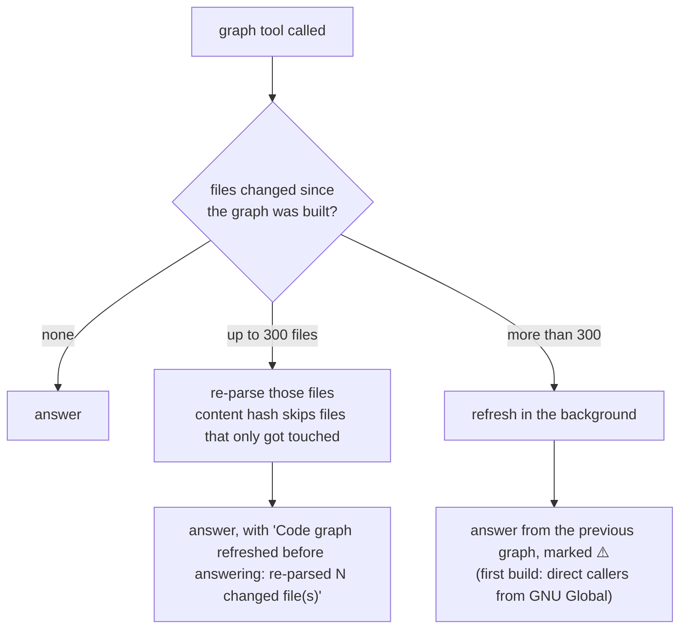

<!-- nav:top -->
📚 [Documentation](README.md) › **The code graph**
<!-- /nav:top -->

# The code graph

GNU Global answers "who mentions `process_packet`?" one level at a time. Questions an agent actually asks go further:
*what does this change affect three calls up? can a network thread reach it? which tests cover it? is `send_frame`
overridden?* The code graph answers those in one call. It is a small SQLite database built from Universal Ctags and the
comment-stripped source, without compiling anything, and it keeps itself fresh.

<!-- nav:toc -->
**On this page:** [What it stores](#what-it-stores) · [How a call is resolved](#how-a-call-is-resolved) · [How it stays fresh (after git pull, a branch switch or an edit)](#how-it-stays-fresh-after-git-pull-a-branch-switch-or-an-edit) · [Size and speed](#size-and-speed) · [The tools that use it](#the-tools-that-use-it)
<!-- /nav:toc -->

## What it stores

| Table | One row per | Fields |
|---|---|---|
| `files` | C/C++ file | path, size, modification time, SHA-1 of the content |
| `defs` | definition (function, prototype, class, struct, union, enum, enumerator, member, macro) | name, qualified name, kind, lines, scope and scope kind, signature, return type, base classes (`inherits`), properties (`virtual`, `pure`, `override`, …) |
| `calls` | call or reference inside a function | caller (and its line), callee name, qualifier (`Router::`, `obj.`), how (`call`, `member`, `qualified`, `ref`, `thread`), line and source line |
| `includes` | `#include` line | file, line, target |

The schema is shared by both implementations: [`shared/graph/schema.sql`](../shared/graph/schema.sql). The database
is `.staticsight/graph.db`, next to the other indexes (or in the per-user cache with `STATICSIGHT_DATA_DIR=cache`).

**How a file is parsed**
- ctags gives every definition with its end line, scope, signature, base classes and properties.
- Inside each function body (comments and strings blanked), every `name(` that is not a keyword, cast, declaration or
  `std::` call becomes a call row. `obj.f(` and `p->f(` are `member` calls, `C::f(` is `qualified`.
- `&fn`, and a function name passed as an argument, is a `ref`. A function passed to `std::thread`, `std::jthread`,
  `std::async`, `CreateThread`, `_beginthread(ex)`, `QueueUserWorkItem`, the thread-pool and timer-queue APIs,
  `SetTimer`, `RegisterWaitForSingleObject`, `RegisterServiceCtrlHandler(Ex)`, `pthread_create`, `atexit` or `signal`
  is a `thread` row: the function is a thread start routine or callback, which makes it an entry point.

## How a call is resolved

Calls are stored by name and resolved when a question is asked, so one file can be refreshed without touching the
others.

| The call site says | It can reach |
|---|---|
| `f(x)` inside a member of class `C` | `f` of `C` or a class related to it by inheritance; a free function `f` only when `C` has no method `f` |
| `f(x)` in a free function | free functions `f` |
| `C::f(x)` or `ns::f(x)` | functions named `f` in class `C` (and its family) or namespace `ns` |
| `obj.f(x)`, `p->f(x)` | any method `f` of any class (the object's type is not known without compiling) |
| a virtual `Base::f` | also every override in derived classes |
| `std::thread t(fn)`, `&fn` | `fn`, marked as a thread/callback entry |

A member call never reaches a free function, and a qualified call never reaches another class. Entry points are
`main`, `wmain`, `_tmain`, `WinMain`, `wWinMain`, `_tWinMain`, `DllMain` and `ServiceMain`, plus thread start routines and callbacks; tests are
functions in test folders or files (including gtest, Catch and Boost `TEST` macros).

This is a heuristic, and every graph answer says so. It errs towards *more* callers for `obj.f()` (any `f`) and misses
calls through function pointers stored in tables, macros that hide calls, and code generated at build time.

## How it stays fresh (after `git pull`, a branch switch or an edit)

You never rebuild it by hand. Every graph tool call starts with a cheap drift check: the list of C/C++ files (ripgrep,
respecting `.gitignore`) and their sizes and modification times, compared with the `files` table.

| Situation | MCP server | Command line (`staticsight tool …`) |
|---|---|---|
| First start in a repository | builds the graph in the background after the handshake | builds it before answering, with a progress line |
| `git pull` of a few commits, a branch switch, your edits | refreshed before the next graph answer (seconds) | same |
| A huge pull (more than 300 changed files) | background refresh; answers say they may be stale until it finishes | refreshed before answering |
| Files deleted or renamed | their rows are removed on the next refresh | same |

A file whose modification time changed but whose content did not (a checkout that rewrote it) is not re-parsed: the
SHA-1 in `files` matches. Refreshes take a lock file, so two StaticSight processes never write the graph at the same
time. The graph records the HEAD commit it last saw; `get_index_status` shows it.

**Settings**

| Variable | Default | Meaning |
|---|---|---|
| `STATICSIGHT_GRAPH_AUTO_REFRESH` | `1` | `0` turns the automatic refresh off (then `staticsight index build` refreshes it). |
| `STATICSIGHT_GRAPH_AUTO_REFRESH_FILES` | `300` | Largest drift refreshed before answering; above it, the refresh runs in the background. |

`staticsight index build` (or `index refresh`) refreshes the code graph and then the semantic index;
`staticsight index status` shows all three indexes.

## Size and speed

Measured on SomeCPPRepo, a 1.1-million-line production C++ service (1,873 C/C++ files indexed after excludes), on a Linux VM:

| Step | Time |
|---|---|
| First build (every file parsed) | 17.6 s |
| Drift check when nothing changed | 0.04 s |
| `get_impact`, depth 3 (up to 1,400 call sites) | 0.3-0.4 s |
| `find_entry_paths`, up to 10 calls deep (50+ entry points and 80+ threads reached) | 1.7-2.5 s |

The graph holds 69,650 definitions, 141,106 calls and references and 10,143 includes. Re-parsing a typical `git pull`
(tens of files) takes well under a second, so the refresh before an answer is not noticeable.

## The tools that use it

[`get_impact`](MCP_TOOLS.md#20-get_impact), [`get_call_paths`](MCP_TOOLS.md#21-get_call_paths),
[`find_entry_paths`](MCP_TOOLS.md#22-find_entry_paths), [`get_type_hierarchy`](MCP_TOOLS.md#23-get_type_hierarchy),
[`query_graph`](MCP_TOOLS.md#24-query_graph), [`get_context_pack`](MCP_TOOLS.md#19-get_context_pack),
[`find_switch_coverage`](MCP_TOOLS.md#26-find_switch_coverage), [`find_counterparts`](MCP_TOOLS.md#27-find_counterparts),
[`find_related_tests`](MCP_TOOLS.md#28-find_related_tests), [`get_change_hotspots`](MCP_TOOLS.md#30-get_change_hotspots),
[`find_log_origin`](MCP_TOOLS.md#31-find_log_origin), [`plan_change`](MCP_TOOLS.md#18-plan_change),
[`check_my_edit`](MCP_TOOLS.md#17-check_my_edit), the virtual-method note of
[`get_upstream_callers`](MCP_TOOLS.md#5-get_upstream_callers), and sections 11-13 of
[`review_changes`](MCP_TOOLS.md#1-review_changes).

<!-- nav:bottom -->
| ⬅️ [MCP tool reference](MCP_TOOLS.md) | 📚 [Documentation](README.md) | [Raw commands](COMMANDS.md) ➡️ |
|:---|:---:|---:|
<!-- /nav:bottom -->
