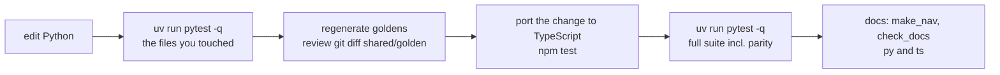

<!-- nav:top -->
📚 [Documentation](README.md) › **Developer guide**
<!-- /nav:top -->

# Developer guide

This page is for people who **change StaticSight itself**: fix a bug, add a tool, update a dependency. It walks through
setting up both implementations in isolated environments, running every kind of test, and the checks a change must pass
before it is ready. To *use* StaticSight on your C++ code you don't need any of this; see [Getting started](getting-started.md).

<!-- nav:toc -->
**On this page:** [1. What you are setting up](#1-what-you-are-setting-up) · [2. Install the engines (once per machine)](#2-install-the-engines-once-per-machine) · [3. Python: create the environment with uv (recommended)](#3-python-create-the-environment-with-uv-recommended) · [4. Python without uv: venv + pip (alternative)](#4-python-without-uv-venv--pip-alternative) · [5. TypeScript: install the packages](#5-typescript-install-the-packages) · [6. Run the tests](#6-run-the-tests) · [7. The everyday loop](#7-the-everyday-loop) · [8. Golden files](#8-golden-files) · [9. Documentation checks](#9-documentation-checks) · [10. Beyond the unit tests](#10-beyond-the-unit-tests) · [11. Changing dependencies](#11-changing-dependencies) · [12. Adding a tool: the checklist](#12-adding-a-tool-the-checklist) · [13. Continuous integration](#13-continuous-integration) · [14. Troubleshooting](#14-troubleshooting)
<!-- /nav:toc -->

## 1. What you are setting up

StaticSight has two implementations of the same MCP server, and one folder of shared data that both read.

```text
StaticSight/
├── shared/            ← the contract: tool-spec.json, prompts, graph schema, test repository (fixtures), goldens
├── staticsight-py/    ← Python implementation   → its own virtual environment: staticsight-py/.venv
├── staticsight-ts/    ← TypeScript implementation → its own packages: staticsight-ts/node_modules
├── staticsight.py     ← plain launcher for users (standard library only; not used for development)
├── docs/              ← these pages, plus check_docs.py and make_nav.py
└── scripts/           ← installers, benchmark.py, eval_agent.py, parity_check.py
```

| You need | For | Where it lives |
|---|---|---|
| The engines: `ctags` (Universal Ctags), `rg`, `git`, `cppcheck`, GNU Global (`global`, `gtags`) | every tool, and every test | installed system-wide (step 2) |
| Python ≥ 3.10 and **uv** | the Python implementation and its tests | `staticsight-py/.venv`, created by `uv sync` (step 3) |
| Node.js ≥ 22.13 and npm | the TypeScript implementation and its tests | `staticsight-ts/node_modules`, created by `npm ci` (step 5) |

The two environments are independent. Nothing is installed into your system Python or globally into Node.

> 💡 **Why a virtual environment?** Your system `python3` usually does not have the `mcp` package, and should not get
> it: a project environment keeps StaticSight's exact dependency versions away from everything else on your machine.
> This is also why `python3 staticsight.py …` can say *"missing Python package(s): mcp"* while the tests pass: the tests
> run inside `.venv`, the plain launcher uses whatever `python3` you called.

## 2. Install the engines (once per machine)

The tests run the real engines on a real git repository, so they must be installed. The installer scripts show a plan
and ask before changing anything.

### 🐧 Linux · macOS


```text
cd /path/to/StaticSight
scripts/install.sh                 # apt, dnf, tdnf or brew; add --yes to skip the question
```

### 🪟 Windows


```powershell
cd C:\path\to\StaticSight
.\scripts\install.ps1              # scoop, winget or choco; add -Yes to skip the question
```

The golden outputs in `shared/golden/` were produced with **cppcheck 2.18.3** and **Universal Ctags 6.1**. Other
versions work, but a few goldens may differ in wording (section 8 explains how CI deals with that). The manual install
steps for each engine are in [Getting started](getting-started.md).

## 3. Python: create the environment with uv (recommended)

[uv](https://docs.astral.sh/uv/) creates the virtual environment, installs the exact versions from the lock file and
runs commands inside it, in one tool.

### 3.1 Install uv

#### 🐧 Linux · macOS

```text
curl -LsSf https://astral.sh/uv/install.sh | sh     # or: brew install uv   or: pipx install uv
uv --version                                        # e.g. uv 0.12.7
```

#### 🪟 Windows

```powershell
powershell -ExecutionPolicy ByPass -c "irm https://astral.sh/uv/install.ps1 | iex"   # or: winget install --id=astral-sh.uv
uv --version
```

Open a new terminal afterwards so `uv` is on `PATH`.

### 3.2 Create the environment and download the packages: `uv sync`

Run it inside `staticsight-py/`, the folder with `pyproject.toml` and `uv.lock`. The command is the same on every OS:

```text
cd staticsight-py
uv sync
```

The first run prints something like:

```text
Using CPython 3.12.9 interpreter at: /usr/bin/python3
Creating virtual environment at: .venv
Resolved 64 packages in 1ms
Installed 53 packages in 131ms
 + annotated-doc==0.0.5
 + annotated-types==0.8.0
 + anyio==4.15.1
 ...
```

What `uv sync` does, step by step:

1. **Finds a Python** that satisfies `requires-python = ">=3.10"` in `pyproject.toml`. If none is installed, uv downloads
   one. To choose a version explicitly: `uv sync --python 3.12`.
2. **Creates `staticsight-py/.venv/`** if it does not exist. It is git-ignored and belongs to this checkout only.
3. **Reads `uv.lock`**, the committed lock file with the exact version and hash of every package (64 resolved; 53 are
   needed on your platform). Everyone, and CI, gets the same versions.
4. **Downloads and installs** them into `.venv`:

   | Group | Packages | Why |
   |---|---|---|
   | runtime (`dependencies`) | `mcp[cli]` (FastMCP) and what it needs: `pydantic`, `anyio`, `httpx`, `starlette`, `uvicorn`, … | the MCP server |
   | `dev` (dependency group, installed by default) | `pytest`, `pytest-asyncio`, `numpy`, `onnxruntime`, `tokenizers` | the tests, including semantic search |
   | the project itself | `staticsight-mcp`, **editable** | your edits in `src/staticsight/` take effect immediately, no reinstall |

5. **Removes anything that is not in the lock file** (a sync is exact), so the environment always matches `uv.lock`.

Run `uv sync` again whenever `pyproject.toml` or `uv.lock` changes, for example after a `git pull`. When nothing
changed it finishes in milliseconds:

```text
Resolved 64 packages in 1ms
Checked 53 packages in 1ms
```

Useful variants:

| Command | Does |
|---|---|
| `uv sync --locked` | Fails instead of updating `uv.lock` if the lock file no longer matches `pyproject.toml` (what CI should use). |
| `uv sync --all-extras` | Also installs the optional `semantic` extra (already covered by the `dev` group today). |
| `uv sync --no-dev` | Runtime packages only: what a user gets. |
| `uv tree --depth 1` | Shows what is installed and why. |
| `rm -rf .venv && uv sync` (🪟 `Remove-Item -Recurse .venv; uv sync`) | Rebuild the environment from scratch. |

```text
$ uv tree --depth 1
staticsight-mcp v0.1.0
├── mcp[cli] v1.30.0
├── numpy v2.5.3 (group: dev)
├── onnxruntime v1.30.0 (group: dev)
├── pytest v9.1.1 (group: dev)
├── pytest-asyncio v1.4.0 (group: dev)
└── tokenizers v0.23.2 (group: dev)
```

### 3.3 Run commands in the environment

**Option A: `uv run` (no activation needed).** It syncs if needed, then runs the command with `.venv`'s Python:

```text
uv run pytest -q
uv run staticsight help
uv run python -c "import sys; print(sys.executable)"   # …/staticsight-py/.venv/bin/python3
```

**Option B: activate the environment,** then use `python`, `pytest` and `staticsight` directly:

#### 🐧 Linux · macOS

```text
source .venv/bin/activate
pytest -q
staticsight help
deactivate
```

#### 🪟 Windows

```powershell
.venv\Scripts\Activate.ps1          # cmd.exe: .venv\Scripts\activate.bat
pytest -q
staticsight help
deactivate
```

> 💡 If PowerShell refuses to run the script, allow local scripts once: `Set-ExecutionPolicy -Scope CurrentUser RemoteSigned`.

Point your editor at the same interpreter (VS Code: *Python: Select Interpreter* → `staticsight-py/.venv`) so imports,
go-to-definition and the test explorer use it.

### 3.4 Check the environment

```text
uv run staticsight doctor          # engines, versions, workspace, data folder
uv run pytest -q tests/test_spec.py
```

`doctor` must show every engine as found; `test_spec.py` takes a second and proves the package imports and matches
`shared/tool-spec.json`.

## 4. Python without uv: `venv` + pip (alternative)

If you cannot install uv, the standard library works too. You lose the lock file (pip resolves versions itself), so
use this for local work only.

### 🐧 Linux · macOS

```text
cd staticsight-py
python3 -m venv .venv                                   # Debian/Ubuntu: sudo apt-get install python3-venv first
.venv/bin/python -m pip install --upgrade pip
.venv/bin/python -m pip install -e ".[semantic]" pytest pytest-asyncio
source .venv/bin/activate
pytest -q
```

### 🪟 Windows

```powershell
cd staticsight-py
py -3 -m venv .venv
.venv\Scripts\python.exe -m pip install --upgrade pip
.venv\Scripts\python.exe -m pip install -e ".[semantic]" pytest pytest-asyncio
.venv\Scripts\Activate.ps1
pytest -q
```

- `-e` installs the project **editable**, so it runs from `src/` and finds `../shared/` directly.
- `".[semantic]"` adds `onnxruntime`, `tokenizers` and `numpy`; `pytest` and `pytest-asyncio` are the test tools
  (the same as uv's `dev` group).
- This is not the same as the user install (`python3 staticsight.py --install`, which installs `requirements*.txt` for
  the plain launcher). For development, always use a project environment.

## 5. TypeScript: install the packages

Needs Node.js ≥ 22.13 (`node --version`; the code uses the built-in `node:sqlite`). Run inside `staticsight-ts/`, the
same on every OS:

```text
cd staticsight-ts
npm ci
```

- **`npm ci`** deletes `node_modules/` and installs exactly what `package-lock.json` says: the MCP SDK, `zod`, and for
  development `typescript`, `vitest` and `@types/node`. `onnxruntime-node` and `@huggingface/tokenizers` are
  *optional*: semantic search with the real model needs them; the tests use a deterministic test embedder.
- Use **`npm install`** only when you intend to change dependencies (it may update `package-lock.json`).
- `npm audit` warnings are about development-only packages; they do not affect the server.

Build and type-check:

```text
npm run build        # tsc → dist/, then copies shared/ into dist/_shared (scripts/copy-shared.mjs)
npm run typecheck    # tsc --noEmit: type errors only, no output
node dist/server.js help
```

`npm test` always builds first, so `dist/` is never stale in tests. When you run `node dist/server.js …` by hand after
editing `src/`, run `npm run build` first.

## 6. Run the tests

Both suites build the test repository from `shared/fixtures/` (a real git repository with planted bugs) in a temporary
folder, index it with the real engines, and run every tool on it.

### Python

```text
cd staticsight-py
uv run pytest -q                                   # everything, about 2 minutes (244 tests)
uv run pytest -q tests/test_tools.py               # one file
uv run pytest -q -k "lock_order or switch"         # tests whose name matches
uv run pytest -q "tests/test_golden.py::test_golden[impact__process_packet]"   # one case
uv run pytest -q -x --lf                           # stop at the first failure; rerun only last failures
```

| File | Checks |
|---|---|
| `test_tools.py` | every planted bug in the test repository is surfaced |
| `test_golden.py` | every case in `shared/golden/cases.json` gives exactly the stored Markdown |
| `test_v3.py` | code graph refresh, finding IDs and `verify_finding`, `check_my_edit`, `get_more`, the cppcheck project library, prompts, `serve` |
| `test_entry.py` | the `staticsight.py` launcher, `--repo`, the `tool` runner, `serve` / `--server`, benchmark and eval scripts; **runs the TypeScript build on every golden case** when `staticsight-ts/dist` exists |
| `test_protocol.py` | a real MCP client talking to the server over stdio |
| `test_spec.py` | docstrings and parameters equal `shared/tool-spec.json` |
| `test_degradation.py` | missing engines, timeouts and hostile input give Markdown error cards, never crashes |
| `test_platform.py` | Windows and POSIX rules; no OS checks outside the platform layer |
| `test_semantic.py` | chunking, index, drift policy and the semantic CLI |
| `test_units.py`, `test_docs.py` | helpers; documentation links |

### TypeScript

```text
cd staticsight-ts
npm test                                  # build + all tests (128)
npx vitest run test/v3.test.ts            # one file (run `npm run build` first if you changed src/)
npx vitest run -t "check_my_edit"         # tests whose name matches
```

The TypeScript files mirror the Python ones (`golden`, `v3`, `protocol`, `degradation`, `platform`, `semantic`,
`toolrun`, `units`). `golden.test.ts` reads the same `shared/golden/*.md` files: that is the byte-for-byte parity check.

> ⚠️ Run the TypeScript suite *before* the Python one when you changed TypeScript code: `test_entry.py` compares the
> TypeScript build in `dist/` with Python, and `npm test` is what rebuilds it.

## 7. The everyday loop



1. Change the Python implementation first; it is the reference.
2. Run the tests of the area you touched.
3. If the output of a tool changed on purpose, regenerate the goldens (section 8) and **read the diff**: every changed
   line should be one you intended.
4. Make the same change in TypeScript until `npm test` passes: the goldens now define the expected bytes.
5. Run the full Python suite; it includes the TypeScript-versus-Python check through the command line.
6. Update the documentation (section 9).

## 8. Golden files

`shared/golden/cases.json` lists tool calls (one per line); `shared/golden/<id>.md` holds the exact Markdown each must
return. Python writes them, both suites compare against them.

```text
cd staticsight-py
STATICSIGHT_UPDATE_GOLDEN=1 uv run pytest -q tests/test_golden.py      # 🪟 PowerShell: $env:STATICSIGHT_UPDATE_GOLDEN=1; uv run pytest -q tests/test_golden.py
git diff --stat shared/golden                                          # (from the repository root)
cd ../staticsight-ts && npm test                                       # TypeScript must now match
```

- **New case:** add a line to `cases.json` (`{"id": "tool__what", "tool": "...", "args": {...}}`) and regenerate.
  A missing golden file is created on the first run.
- **Engine versions:** another cppcheck or ctags version can change a few goldens slightly. CI therefore generates the
  goldens with the runner's own engines into `STATICSIGHT_GOLDEN_DIR` and requires TypeScript to match *those*; the
  comparison with the committed goldens is informational. To reproduce it locally:

  ```text
  cd staticsight-py && STATICSIGHT_GOLDEN_DIR=/tmp/g STATICSIGHT_UPDATE_GOLDEN=1 uv run pytest -q tests/test_golden.py
  cd ../staticsight-ts && STATICSIGHT_GOLDEN_DIR=/tmp/g npx vitest run test/golden.test.ts
  ```

## 9. Documentation checks

```text
python3 docs/make_nav.py                                   # breadcrumbs, "On this page", previous/next links
cd staticsight-py
uv run python ../docs/check_docs.py                        # runs every command in the guides + checks links (Python)
uv run python ../docs/check_docs.py --impl ts              # the same commands through TypeScript
uv run python ../docs/check_docs.py --links-only           # fast: links and anchors only
```

`check_docs.py` builds a fresh test repository and runs each `staticsight …` line from the guides' `bash` blocks; a line
ending in `# exit N` must exit with N. Add a command to a guide and it is tested from then on. Run it with the
environment's Python (`uv run python`), because the commands start the Python implementation.

## 10. Beyond the unit tests

| Script | When | Command |
|---|---|---|
| `scripts/parity_check.py` | after changing tool output or the code graph: compares Python and TypeScript on a *real* repository (hundreds of sampled calls), which catches ordering ties a small fixture cannot show | `uv run python ../scripts/parity_check.py /path/to/cpp/repo 12` |
| `scripts/eval_agent.py` | after changing what a tool reports: are the planted bugs still found? | `uv run python ../scripts/eval_agent.py` |
| `scripts/benchmark.py` | tokens, precision and speed on a real repository | `uv run python ../scripts/benchmark.py --repo /path/to/repo` |

All three are read-only for the repository they measure (indexes go to a temporary or per-user cache).

## 11. Changing dependencies

### Python

```text
cd staticsight-py
uv add "somepackage>=1.2"            # runtime dependency: updates pyproject.toml, uv.lock and .venv
uv add --dev "pytest-timeout>=2"     # development only (dependency group "dev")
uv remove somepackage
uv lock --upgrade-package mcp        # move one package to its newest allowed version
uv lock --upgrade                    # everything (review the diff carefully)
uv sync                              # apply the lock file to .venv
```

Commit `pyproject.toml` **and** `uv.lock` together. Runtime dependencies are also listed in the repository root's
`requirements.txt` / `requirements-semantic.txt` for users without uv, and a test fails until they match
`pyproject.toml`. Without uv, edit `pyproject.toml` by hand and reinstall with `pip install -e ".[semantic]"`.

### TypeScript

```text
cd staticsight-ts
npm install somepackage              # updates package.json and package-lock.json
npm install -D somepackage           # development only
npm uninstall somepackage
```

Commit `package.json` and `package-lock.json` together; CI uses `npm ci`, which fails if they disagree.

## 12. Adding a tool: the checklist

1. **Spec:** add the tool to `shared/tool-spec.json`: name, description (it tells the agent *when* to use the tool),
   parameters with types and defaults.
2. **Python:** implement it in `staticsight-py/src/staticsight/tools/`, with a docstring equal to the spec description,
   and add it to `TOOLS` in `server.py` in spec order. Errors raise `StaticSightError` subclasses (they become Markdown
   cards); findings use `record(...)` from `tools/findings.py`; long lists use `md.truncate_list`.
3. **Tests:** behaviour tests in `tests/`, and golden cases in `shared/golden/cases.json`; regenerate the goldens.
4. **TypeScript:** the twin in `staticsight-ts/src/tools/`, registered in `server.ts`; `npm test` until the goldens match.
   Engines are run only through the platform layer; sort strings with `cmpStr` (Python code-point order).
5. **Both suites, parity check, docs:** `docs/MCP_TOOLS.md`, the CLI guide if it has a notable command, the skill in
   `.github/skills/` if agents should use it in a workflow; `make_nav.py`, `check_docs.py` (both implementations).

## 13. Continuous integration

`.github/workflows/ci.yml` and `pipelines/azure-pipelines.yml` run the same steps on Linux and Windows:

1. install the engines with `scripts/install.sh --yes` / `install.ps1 -Yes`;
2. `uv sync`, then `uv run staticsight doctor`;
3. `STATICSIGHT_UPDATE_GOLDEN=1 uv run pytest -q` (Python, writing goldens for this machine's engines);
4. `npm ci && npm test` (TypeScript, which must match them byte for byte);
5. `check_docs.py` with both implementations;
6. the plain launcher without uv: `python staticsight.py --install --yes`, `doctor`, `tool get_index_status`;
7. informational comparison with the committed goldens.

If it passes locally with sections 6-9, it passes in CI, apart from engine-version wording.

## 14. Troubleshooting

| Symptom | Cause and fix |
|---|---|
| `StaticSight: missing Python package(s): mcp` | You ran `python3 staticsight.py …` with a Python outside the environment. Use `uv run staticsight …`, or activate `.venv` first. |
| `uv: command not found` | Open a new terminal after installing uv, or add `~/.local/bin` (🪟 `%USERPROFILE%\.local\bin`) to `PATH`. |
| `error: The lockfile at uv.lock needs to be updated` (with `--locked`) | `pyproject.toml` changed without `uv lock`. Run `uv lock`, review, commit both files. |
| Tests fail with `ctags ... not found` or `index not ready` | An engine is missing: `uv run staticsight doctor` names it; install it (section 2). |
| Many goldens differ only in cppcheck or ctags wording | Different engine versions (section 8). Compare with CI golden mode instead of rewriting the committed goldens. |
| `test_tool_runner_prints_the_mcp_output` fails but `npm test` passes | `staticsight-ts/dist` is stale: run `npm run build` (or `npm test`) before the Python suite. |
| A Python script run from `/tmp` fails with an odd import error (for example `module 'click' has no attribute ...`) | Python puts the script's folder first on the import path; a stray `click.py` or similar file there shadows the real package. Run scripts from another folder. |
| `ExperimentalWarning: SQLite is an experimental feature` | Harmless on Node 22; StaticSight suppresses it in its own output. |
| Windows: `Activate.ps1 cannot be loaded because running scripts is disabled` | `Set-ExecutionPolicy -Scope CurrentUser RemoteSigned`, or use `uv run` without activating. |

<!-- nav:bottom -->
| ⬅️ [Benchmarks](benchmarks.md) | 📚 [Documentation](README.md) | [Future scope](future-scope.md) ➡️ |
|:---|:---:|---:|
<!-- /nav:bottom -->
